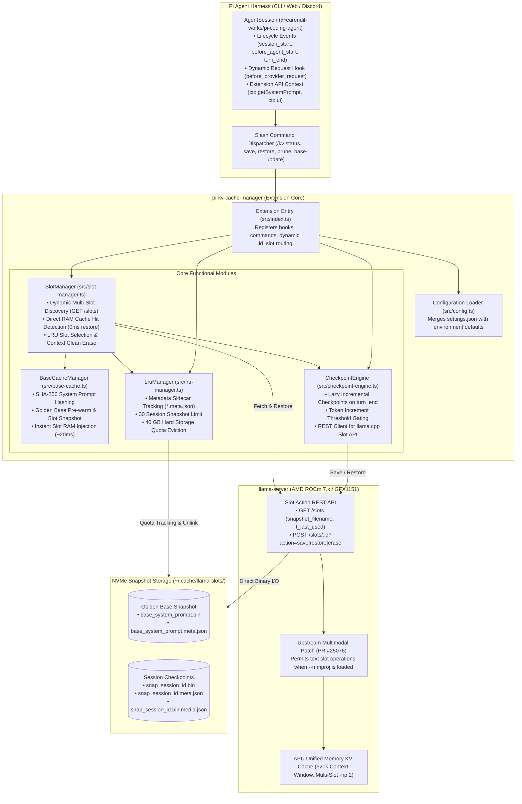
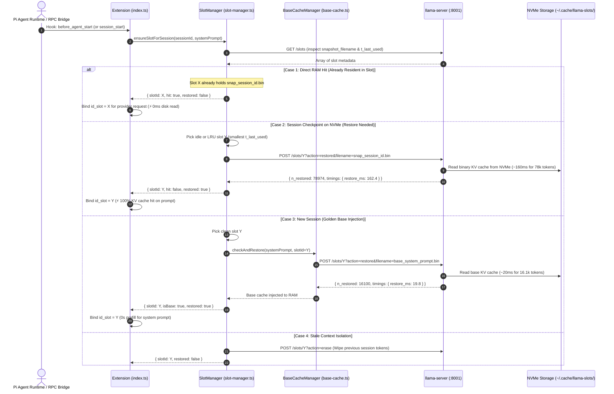
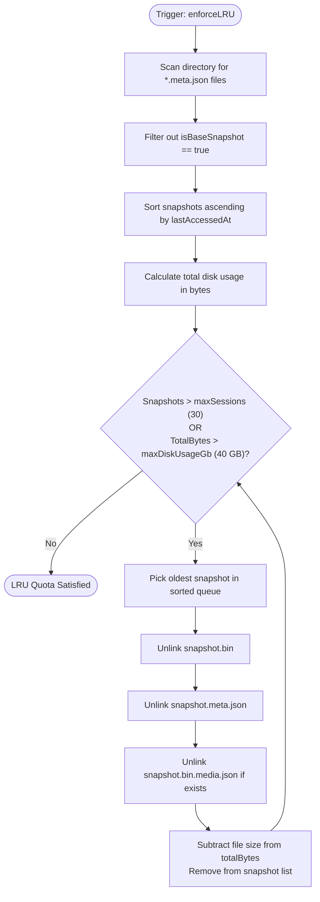
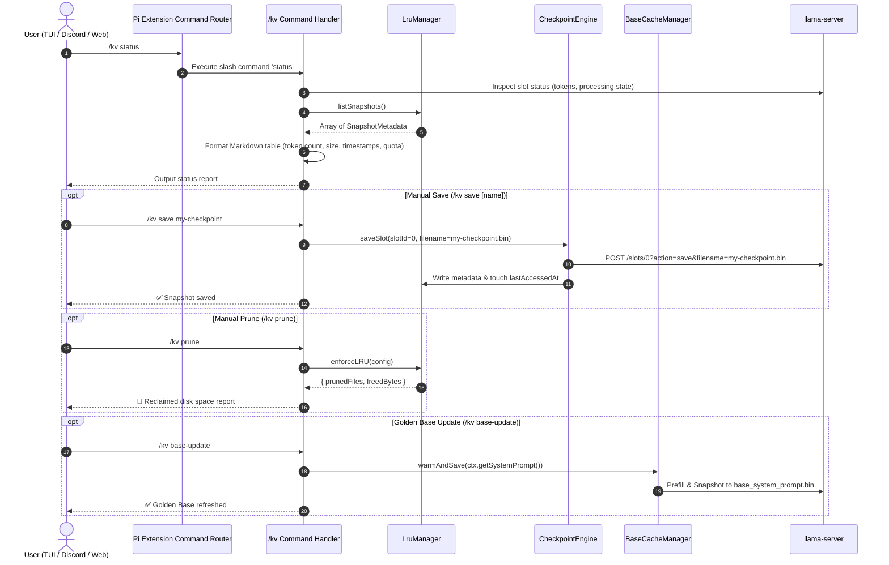

# ⚡ pi-kv-cache-manager

> **High-Performance KV Cache Lifecycle & Snapshot Manager for Pi Agent (`@earendil-works/pi-coding-agent`) & `llama-server`**  
> Cuts long-context cold prefill latency from **~170s to 0.3s (543x speedup)** on local hardware (tested on AMD Strix Halo gfx1151 + NVMe SSD).

---

## Current correctness scope

Historical latency tables below measure controlled snapshot/short-reply workloads, not arbitrary concurrent tool loops. Restore and generation remain separate server operations: another Pi process can take the slot between them. Server eviction-before-save helps preserve snapshots but does not make restore+request atomic. This change does not claim to fix that scheduling race.

Snapshot saving is **awaited and serialized**, not detached background disk writing. llama-server synchronizes the context and writes target/draft/checkpoint files on its main task loop; saves can delay inference. Intermediate tool-call turns skip client checkpointing, while the final turn/run saves once per successful session leaf. Eviction-before-save protects dirty state when switching owners.

See [Snapshot dependencies and validation, 2026-10-05](docs/snapshot-release-20261005.md) for pinned core/server/extension commits, CPU gates, the four-session ten-round live test, and its provenance limits.

See [Silent golden refresh, 2026-10-13](docs/golden-refresh-20261013.md) for AGENTS.md/skill-triggered golden refresh, piweb `/kv base-update`, the discovery-timeout fix and live measurements. Known race measured there: two simultaneous new sessions in separate Pi processes can pick the same slot, and one session's late checkpoint can then save the other session's context into its own snapshot file. Outputs stay correct (token verification), but that session loses its cache on the next restore.

## Single canonical golden

- Each verified model/adapter runtime has one `golden_<runtime-hash>_base_system_prompt.bin` and matching metadata/tools/sidecars. Session checkpoints remain `kv2_<runtime-and-rendered-prefix-hash>_snap_<id>.bin`; prompt differences never allocate another golden.
- The first complete serialized request establishes the canonical cwd. Every outgoing request is audited, including RAM/session hits. A different raw system/tools hash, rendered prefix, or loaded-extension fingerprint writes a structured warning to both stderr and `<server-slot-save-path>/golden-warnings.jsonl`. Logs contain hashes and cwd, not prompt/tool contents.
- Updated Pi core supplies `session_start.extensionsFingerprint` and `extensions_changed`. Loaded extension updates in the **canonical cwd** are adopted without a warm when the rendered prefix is unchanged; otherwise they are refreshed like resource changes: by the next new session in its own slot, seeded from the old golden (2026-10-13; previously a cold warm in the first idle slot during whichever request noticed first). A tool change gains nothing from the seed: Qwen's template renders `<tools>` before the system text, so the prefix diverges at ~2.7k tokens, below the first recurrent checkpoint, and the whole ~27k prefix is re-prefilled (live: 15.6 s, same as cold). Other cwd/extension sets warn and preserve golden. Older already-loaded workers cannot roll it back. `/kv base-update` explicitly replaces golden and may select a new canonical cwd.
- **Silent refresh on context-file/skill changes (2026-10-13).** AGENTS.md and skills are not extensions, so editing them used to leave golden stale forever (every new session re-prefilled ~12k tokens). Now, in the canonical cwd with the same extension set, golden is refreshed when the request's prompt opens like golden (same head; subagents with their own prompt never qualify), keeps every golden resource, and either (a) a rendered `<project_instructions path>`/skill `<location>` file was edited, created or deleted after golden was built and this worker loaded it afterwards, or (b) two sessions sent the same new prefix that was never golden before (`retired` keys cannot be voted back). The refresh is carried out by the **next new session in its own slot**, seeded from the old golden: llama-server keeps the common token prefix and prefills only the changed suffix (live: 2,131 of 28,168 tokens, 2.8 s). Logged as `refresh-next-session:<reason>` / `golden_refreshed` in `golden-warnings.jsonl`. After `pi install/remove/update`, Pi's `after-package-change` hook runs `scripts/golden-prewarm.py`, so the refresh is done in the background before a real session arrives ([details](docs/golden-refresh-20261013.md#prewarm-on-package-changes-2026-10-14)).
- **`/kv base-update` from piweb/Discord.** Those hosts run every slash command in a fresh one-shot pi process that has no verified prefix, so the command used to answer "Persistent KV unavailable" and change nothing. Without a live prefix it now writes `golden_<runtime>_refresh.request`; the next new session in that cwd rebuilds golden from its exact serialized prefix (or just consumes the request if golden already matches: identical prompts cannot be re-evaluated in place on hybrid models).
- Discovery `/props` and `/lora-adapters` are answered from llama-server's main loop and queue behind ubatches/image encodes. Their 2 s deadline timed out under load and the TimeoutError silently discarded finished golden warms and slot bindings; the deadline is now 30 s.
- Pi checks loaded extension source contents at the next idle user prompt and reloads changed extensions before that prompt. Streaming/tool loops are not hot-reloaded. New extension discovery still follows Pi resource reload/startup. Runtime logs, virtualenvs and tests do not trigger a source update.
- Publication uses a per-runtime directory lock, unique staging binary, sidecar backups, rollback on errors and metadata-last publication. Failed warm/save leaves the previous golden usable and retries later. Restore holds the same lock. A process crash can leave a lock/backups requiring operator recovery; no unsafe automatic stale-lock deletion is attempted.
- A mismatched golden can be loaded as a **candidate**; llama-server verifies token equality and reuses only its common prefix. Restored snapshot token count is not the number of prompt tokens actually reused.
- Date context is appended by nodriver-browser as a hidden `browser-date-context` message. It is no longer part of the system prefix, and earlier date messages remain unchanged.
- `/kv status` exposes the canonical filename/cwd, warning log, loaded/golden fingerprints and pending refresh. Core must be rebuilt and workers started with the updated core for automatic change detection; updating the KV extension alone cannot add core events.

## 🎯 Motivation & Empirical Proof

On large Mixture-of-Experts and dense models (such as Qwen 3.6 35B-A3B), context evaluation exhibits quadratic scaling:

$$T(N) = c_1 N + c_2 N^2 \quad (c_1 \approx 0.6 \text{ ms/tok}, \; c_2 \approx 3.72 \times 10^{-9} \text{ s/tok}^2)$$

When working with long coding agent sessions (100k ~ 260k tokens), restarting a session or loading a new context forces the GPU to chew through gigabytes of attention matrices for **2 to 3 minutes** before generating a single token (TTFT).

### Empirical Benchmarks on AMD Strix Halo (NVMe SSD)

| Context Length | Cold GPU Prefill | Snapshot Size | NVMe Restore Time | **Speedup Factor** |
| :--- | :---: | :---: | :---: | :---: |
| **20,000 tokens** | 14.00 s | 453.9 MB | 0.036 s | **393x** |
| **50,000 tokens** | 35.70 s | 1.02 GB | 0.117 s | **304x** |
| **100,000 tokens** | 101.40 s | 1.97 GB | 0.216 s | **470x** |
| **150,000 tokens** | 170.59 s | 2.93 GB | 0.314 s | **543x** |

Instead of re-evaluating 150k tokens (consuming ~2.8 minutes of 100W APU heat), reading 2.9 GB from NVMe takes **~0.3 seconds**.

### 🏆 Multi-Session Switching Stress Test (10 Sessions × 78k Tokens)

To prove reliability under multi-user / multi-channel thrashing, we executed a 15-jump randomized switching stress test across **10 concurrent persistent RPC sessions**, each carrying **78,974 tokens** of context (>780,000 tokens total), on a dual-slot (`-np 2`, 260k context per slot) server:

| Jump # | Target Session (78k Tokens) | Cache Hit Mechanism | Turnaround Latency | Context Recall & Integrity |
| :---: | :--- | :--- | :---: | :---: |
| **#01** | `S08-雷霆泰坦` | NVMe Restore | **3.43 s** | ✅ PASS (100% match) |
| **#02** | `S04-深海巨鯊` | NVMe Restore | **4.52 s** | ✅ PASS (100% match) |
| **#03** | `S03-黃金獵鷹` | NVMe Restore | **4.43 s** | ✅ PASS (100% match) |
| **#04** | `S09-冰霜巨狼` | NVMe Restore | **4.77 s** | ✅ PASS (100% match) |
| **#05** | `S06-翡翠靈鹿` | NVMe Restore | **4.27 s** | ✅ PASS (100% match) |
| **#06** | `S07-白銀天馬` | NVMe Restore | **6.27 s** | ✅ PASS (100% match) |
| **#07** | `S10-恆星幼龍` | NVMe Restore | **4.72 s** | ✅ PASS (100% match) |
| **#08** | `S05-暗影黑豹` | NVMe Restore | **4.75 s** | ✅ PASS (100% match) |
| **#09** | `S01-極光鯨魚` | NVMe Restore | **4.09 s** | ✅ PASS (100% match) |
| **#10** | `S02-赤紅鳳凰` | NVMe Restore | **4.96 s** | ✅ PASS (100% match) |
| **#11** | `S10-恆星幼龍` | NVMe Restore | **4.32 s** | ✅ PASS (100% match) |
| **#12** | `S07-白銀天馬` | NVMe Restore | **5.31 s** | ✅ PASS (100% match) |
| **#13** | `S01-極光鯨魚` | NVMe Restore | **3.79 s** | ✅ PASS (100% match) |
| **#14** | `S01-極光鯨魚` | **Direct RAM Hit (Slot 0)** | **2.87 s** | ✅ PASS (100% match) |
| **#15** | `S02-赤紅鳳凰` | NVMe Restore | **4.23 s** | ✅ PASS (100% match) |

* **Average Turnaround Latency**: **4.45 s** (includes thinking model generation + streaming output)
* **RAM Cache Hit (Slot 0 Resident)**: **2.87 s** (zero disk read)
* **Context Integrity**: **100% (15/15 PASS)** — every session accurately recalled its unique session identity and verified complete 78k backstory.
* **Prefill Avoided**: Eliminated **>80 seconds** of quadratic full re-evaluation penalty on every session switch.

---

## 🏛️ Software Architecture

`pi-kv-cache-manager` operates as an extension for Pi Agent. It sits between the agent lifecycle hooks and the underlying `llama-server` slot management REST API, coordinating disk snapshots, LRU quotas, and prompt cache hashes.



---

## 🔄 Detailed Workflows

### 1. Multi-Slot Resolution & Warm-Start Workflow (`before_agent_start` & `session_start`)

When a new session opens or an interactive turn arrives in a persistent RPC worker (`pi --mode rpc`), `SlotManager` resolves slot residency before prompt execution:



---

### 2. Awaited Checkpointing on Final `turn_end` / `agent_end`

Intermediate turns with tool results skip checkpointing. Final turns and `agent_end` await the serialized save when thresholds are met. Successful saves are deduplicated by session/slot/message leaf; failed saves remain retryable. This reduces redundant work but does not make server disk I/O concurrent with inference:

```mermaid
sequenceDiagram
    autonumber
    actor Agent as Pi Agent
    participant Ext as Extension (index.ts)
    participant Engine as CheckpointEngine (checkpoint-engine.ts)
    participant Lru as LruManager (lru-manager.ts)
    participant Llama as llama-server (:8001)
    participant Disk as NVMe Storage (~/.cache/llama-slots/)

    Agent->>Ext: Hook: turn_end
    Ext->>Ext: Inspect current token count & step delta
    
    alt Tokens < minTokensThreshold (3,000) OR Delta < stepTokensIncrement (3,000)
        Ext-->>Agent: Skip checkpoint (turn context too small)
    else Checkpoint Threshold Met
        Ext->>Engine: queueLazySave(sessionId, tokens, slotId=0)
        Note over Engine: Awaited in the runtime queue; can delay the next request
        Engine->>Llama: POST /slots/0?action=save&filename=session_session_id.bin
        Llama->>Disk: Save binary KV tensors to NVMe
        Llama-->>Engine: { n_saved: 45000, n_written: 960000000, timings: { save_ms: 95.4 } }
        Engine->>Disk: Write session_session_id.meta.json
        Engine->>Lru: enforceLRU(config)
        Note over Lru,Disk: Check 30 sessions max & 40 GB limit
        Lru-->>Engine: Quota compliant
        Engine-->>Ext: Checkpoint complete
        Ext->>Ext: Update UI Status: [KV: 45k 💾]
    end
```

---

### 3. LRU Quota Eviction & Storage Budget Flowchart

The LRU engine guarantees that stored KV snapshots never exhaust disk space:



---

### 4. Extension Slash Command Dispatcher (`/kv`)



---

## 🚀 Key Features

1. **Upstream `llama.cpp` Multimodal Patch (`patches/0001-...`)**:
   - Solves the upstream limitation where loading `--mmproj` disables slot save/restore for all slots.
   - Checks slot-level media chunks rather than the global multimodal context, allowing pure text/code sessions to save and restore seamlessly even while vision models are loaded.

2. **LRU Session Quota & Sidecar Metadata**:
   - Maintains `.meta.json` sidecars tracking `sessionId`, `sessionName`, `tokenCount`, `fileSizeBytes`, and `lastAccessedAt`.
   - Automatically evicts the oldest snapshots when stored sessions exceed `maxSessions` (default: 30) or hard disk quota `maxDiskUsageGb` (default: 40 GB).

3. **Incremental Checkpointing**:
   - Awaits slot saves on final `turn_end` / `agent_end`; skips intermediate tool-call turns and deduplicates successful saves of the same message leaf.
   - Save/restore have a 300-second default I/O deadline because large snapshots can queue behind slot work. This is not a background writer.
   - Activates once context exceeds `minTokensThreshold` (default: 3,000 tokens) and advances by at least `stepTokensIncrement` (default: 3,000 tokens).
   - If an unexpected shutdown occurs, the next launch restores the snapshot in ~0.2s and only precomputes the trailing delta!

4. **Canonical Golden System Prefix**:
   - Audits the complete serialized system prompt and tools at `before_provider_request`; early `ctx.getSystemPrompt()` alone is insufficient.
   - Keeps one `golden_<runtime-hash>_base_system_prompt.bin` per verified model/adapter runtime. Session namespaces use the rendered system-prefix hash.
   - Loaded-extension changes refresh golden only from its canonical cwd (adopted without a warm when the prefix is unchanged, otherwise via the next new session, seeded). Context-file/skill edits and repeated new prefixes refresh it silently via the next new session (seeded); other prompt/tool differences warn and preserve it. `/kv base-update` explicitly replaces it (scheduled when run from a one-shot command process).
   - A restored golden is only a candidate until llama-server validates token equality; restore token count is not measured prefix reuse.

5. **Multi-Slot Dynamic Routing & Affinity (`SlotManager`)**:
   - Discovers and manages multiple concurrent server slots (`-np 2`, `-np 4`, etc.).
   - Senses `snapshot_filename` and `t_last_used` directly from `llama-server` `/slots`. If a session's KV tensors are already resident in any slot, it routes requests there with **0ms disk read (Direct RAM Cache Hit)**.
   - On cache miss, allocates the least recently used slot based on server timestamps and clears stale context.

6. **Persistent RPC Lifecycle Verification (`before_agent_start`)**:
   - Built specifically for persistent agent workers (`pi --mode rpc`) used in production bridges like `pi-discord-gateway` and `piweb`.
   - In persistent RPC mode, `session_start` only executes once on process boot. Hooking into `before_agent_start` guarantees slot residency and restores snapshots just-in-time before prompt dispatch on every turn.
   - Completely eliminates the silent 80-second quadratic re-evaluation penalty caused by intervening session thrashing.

7. **Zero-Disk-Duplication Golden Base Injection**:
   - New sessions inject the 16.1k-token Golden Base directly into Slot RAM via REST API in ~20ms, completely avoiding wasteful disk file cloning (`cp`) on new session creation.
   - Fully immune to LRU quota eviction.

8. **Qwen `preserve_thinking` & Chat Template Cache Alignment (`patches/0003-...`)**:
   - Fixes upstream Qwen Jinja Chat Template behavior when `preserve_thinking: true`. If reasoning is absent or empty in assistant turns, the default template incorrectly injects `<think>\n\n</think>\n\n` (rogue token 271), causing prefix divergence from the raw KV cache and wiping 50k+ tokens on every subsequent turn.
   - Guards slot save against stale `.media.json` residue, validates media chunk bounds on restore, and calculates checkpoint `pos_max` using `llama_memory_seq_pos_max` to prevent M-RoPE position assertion crashes (`X < Y`).

9. **Hybrid/Recurrent Checkpoint Persistence (`patches/0004-...`)**:
   - Persists in-memory prompt checkpoints to a `.bin.ckpt` sidecar and restores them with the target and MTP draft states.
   - Lets SWA/GDN models roll back across prompt-tail retokenization instead of discarding the restored snapshot and fully prefilling the conversation.
   - LRU accounting and eviction include `.dft`, `.ckpt`, and `.media.json` sidecars.

10. **Snapshot Ownership & Eviction-before-save (`patches/0005-...`)**:
   - Requests carry `slot_snapshot` alongside `id_slot`. Updated Pi speculative prefill preserves this owner marker and refuses to pin if it changes.
   - llama-server saves a dirty owner's context before a different owner replaces it. The patch also always truncates target attention memory after checkpoint rollback.
   - This protects unsaved context but does not create a slot lease or atomic restore+generation operation.

---

## 📦 Installation

### 1. Apply Upstream `llama.cpp` Patches (Recommended)
```bash
git -C /path/to/llama.cpp apply /path/to/pi-kv-cache-manager/patches/0001-allow-text-slot-save-restore-with-mmproj.patch
git -C /path/to/llama.cpp apply /path/to/pi-kv-cache-manager/patches/0002-sync-mtp-draft-kv-cache-slots.patch
git -C /path/to/llama.cpp apply /path/to/pi-kv-cache-manager/patches/0003-fix-qwen-preserve-thinking-and-slot-pos-max.patch
git -C /path/to/llama.cpp apply /path/to/pi-kv-cache-manager/patches/0004-persist-context-checkpoints.patch
git -C /path/to/llama.cpp apply /path/to/pi-kv-cache-manager/patches/0005-save-slot-before-eviction.patch
cmake --build /path/to/llama.cpp/build --target llama-server -j$(nproc)
```

The pinned server fork already contains these fixes; **do not apply the patch bundle again** to it. Patch application is for a compatible unpatched source tree. The automatic loaded-extension refresh and speculative-prefill ownership fixes also require the [pinned Pi core](docs/snapshot-release-20261005.md#pinned-source-baseline), rebuilt with new workers; a stock core or extension-only update is not equivalent.

### 2. Configure `llama-server`
Ensure `llama-server` is started with `--slot-save-path`:
```bash
llama-server \
  -m /path/to/model.gguf \
  --slot-save-path /home/chihmin/.cache/llama-slots/ \
  --port 8001
```

### 3. Install Extension via Pi Package Manager

Install the package directly into Pi Agent using the built-in package manager:

**Option A: Install from Local Source (Development)**
```bash
pi install ~/src/pi-kv-cache-manager
```

**Option B: Install from Git Repository**
```bash
pi install git:https://github.com/AyaSakura-comp/pi-kv-cache-manager.git
```

Verify the installation:
```bash
pi list
```

To update or remove:
```bash
pi update                               # Updates all git packages
pi remove ~/src/pi-kv-cache-manager     # Uninstalls package
```

---

## Server-authoritative snapshot discovery (v2)

Persistent reuse is now resolved **at `before_provider_request`**, with the serialized system prompt and tools, not during early session/model hooks. Settings are reloaded using the current trusted cwd. The selected model's `baseUrl` selects the server; `kvCache.llamaServerUrl` cannot redirect another model to port 8001.

On Linux, a single loopback HTTP listener must be provably owned by `llama-server`: bounded `ss -H -ltnpe` (execFile, no shell), `/proc/<pid>/fd` socket inode, executable, process start identity, network/mount namespaces and filesystem root. The explicit `--slot-save-path` (separate or `=` syntax, relative to the server cwd) is authoritative. Client `cacheDir` / `LLAMA_SLOT_SAVE_PATH` hints never override it. `/props` supplies model/runtime identity, **not** the snapshot directory; `/lora-adapters` must supply loaded adapter paths and scales.

Session files use a `kv2_<hash>_` filename prefix **in the server's directory**; canonical golden files use the runtime-only `golden_<hash>_` prefix described above. The hash binds the model's canonical path and local stat identity, adapters/scales/stat identities, executable, launch arguments/environment, advertised defaults/build, auxiliary model/template files, and serialized system/tools/request options. Metadata must carry the same namespace. Existing unbound files are not imported, copied, trusted, or cleaned up. Golden filenames alone never imply a hit. Warmed and restored results are distinct. Server save/restore still uses filenames only, preserving its `.dft` handling.

An existing worker replaces all managers and RAM/session tracking when the identity, directory, settings or process generation changes. Extension operations are serialized; checkpoints are awaited rather than detached. Runtime guards run around slot work, and an overwrite first tombstones its owned metadata so a stale/failed save cannot inherit a previous valid binding. Failed discovery disables extension-managed persistent reuse and `/kv` mutations; normal provider requests continue without an extension slot assignment. Missing binaries and restore failures are not grounds for deleting files.

### Deliberate limits

- Direct `http://localhost[:port]`, `http://127.0.0.1[:port]` and `http://[::1][:port]` endpoints, optionally `/v1`, are supported without configuration changes (including `http://localhost:8001/v1`). `localhost` DNS has a 2-second deadline; every answer must be exactly IPv4/IPv6 loopback. Empty/non-loopback answers or multiple listeners fail closed. Dual-stack loopback answers are allowed only with one verified listener. Requests retain the selected hostname, port and Host header; a Node HTTP transport pins the validated DNS answers rather than re-resolving between validation and connection. No alternate configured endpoint or redirect is used. Other DNS names, HTTPS, proxies/routers, containers/chroots, inaccessible `/proc`, missing explicit model/save-path flags, split GGUFs, and missing identity APIs fail closed. No remote disk management is promised.
- HTTP deadlines include headers **and complete response bodies**: discovery 2 seconds, lightweight slot/template control calls 5 seconds, and snapshot save/restore plus potentially large golden prefills 300 seconds. Internal/embedded callers may override `controlTimeoutMs` / `prefillTimeoutMs` and supply an optional `signal`; these are not new user settings. AbortSignal is passed to the actual transport. A runtime timeout aborts that runtime; cold fallback cannot continue destructive work on it.
- Model selection, session start/switch/shutdown, and a changed model/session on a provider request immediately abort active runtime I/O before waiting for the serialized queue. Queued old work is skipped, stale slot assignment/metadata publication/UI callbacks are guarded, and the next provider request can discover a fresh runtime. Cancellation cannot undo an operation already accepted by llama-server or a filesystem syscall already issued; failed saves retain pending metadata, not a valid snapshot. OS DNS lookup itself is not cancellable, but late answers cannot initiate requests or mutate runtime state. CPU fixtures cover cancellation; real server behavior remains a separate parent live-test.
- Per-request LoRA/adapter overrides fail closed; change server adapters/scales instead. A single string-valued leading system message is required. Later extensions can still rewrite a payload: put this extension after payload-mutating extensions.
- Stat identity uses device/inode/size/mtime/ctime, **not weight-file hashing**. Files must remain immutable while loaded; restart the server after replacing model/adapter/auxiliary files. This is not a content-addressed or adversarial tamper guarantee.
- External server/adapter changes cannot be transactionally locked by the current API. Guards detect observed changes and discard stale metadata, but cannot prevent an external change in the final check-to-request gap. Independent Pi processes do not share a slot lease/lock.
- `maxSessions` applies to the active session namespace; disk accounting spans metadata-bound `kv2_` / `golden_` namespaces and includes binary sidecars. Only owned non-base session snapshots are evictable. Pending/unbound/legacy files are preserved and excluded from accounting; golden snapshots are counted but never evicted, so the configured disk budget is not a hard cap on all directory contents. `/kv` mutations require a previously verified full provider request; named restores are namespace-bound, not arbitrary filename imports.

### CPU regression tests

```bash
npm test
```

Uses the existing TypeScript compiler and Node's built-in test runner. Tests isolate HOME before loading modules, forbid unfixture'd fetches, and use temporary `/proc`/listener/API fixtures; no server, GPU or network access is needed.

## ⚙️ Configuration

Configuration is loaded from `~/.pi/agent/settings.json` (global) or `.pi/settings.json` (project-local):

```json
{
  "kvCache": {
    "llamaServerUrl": "http://127.0.0.1:8001",
    "slotId": 0,
    "cacheDir": "/home/chihmin/.cache/llama-slots",
    "maxSessions": 30,
    "maxDiskUsageGb": 40,
    "minTokensThreshold": 3000,
    "stepTokensIncrement": 3000,
    "enableBaseCache": true,
    "enableIncrementalSave": true
  }
}
```

### Configuration Options

| Option | Type | Default | Description |
| :--- | :--- | :--- | :--- |
| `llamaServerUrl` | `string` | `http://127.0.0.1:8001` | Legacy hint; runtime uses the selected model's verified endpoint |
| `slotId` | `number` | `0` | Active llama.cpp slot ID to manage |
| `cacheDir` | `string` | `~/.cache/llama-slots` | Legacy hint; runtime uses the verified server's slot-save-path |
| `maxSessions` | `number` | `30` | Maximum number of session snapshots before LRU eviction |
| `maxDiskUsageGb` | `number` | `40` | Hard disk quota in Gigabytes before LRU eviction |
| `minTokensThreshold` | `number` | `3000` | Minimum token count before automatic turn snapshots activate |
| `stepTokensIncrement` | `number` | `3000` | Token growth required between consecutive automatic snapshots |
| `enableBaseCache` | `boolean` | `true` | Enables Golden Base System Prompt & Skills prefill caching |
| `enableIncrementalSave`| `boolean` | `true` | Enables awaited checkpoints on final `turn_end` / `agent_end` |

---

## ⌨️ Slash Commands (`/kv`)

| Command | Description |
| :--- | :--- |
| `/kv status` | Shows cache status, disk space used, base cache stats, and active session snapshots |
| `/kv save [name]` | Manually saves current slot state to session snapshot or a custom named checkpoint |
| `/kv restore [name]` | Manually restores slot from a specified snapshot file |
| `/kv prune` | Manually triggers LRU cleanup to reclaim SSD disk space |
| `/kv base-update` | Forces prefilling and updating the Golden Base System Prompt snapshot |
| `/kv help` | Displays available commands and usage guide |

---

## 📊 Status Bar Indicators

The extension dynamically updates the status line in Pi's UI footer:
- `[KV: 110k ⚡]`: Instant restore completed for 110,000 tokens.
- `[KV: 115k 💾]`: Awaited incremental snapshot written to NVMe SSD.
- `[KV: Base 28k ⚡]`: Golden Base cache hit; instant cold start achieved.
- `[KV: Base 28k 💾]`: Golden Base pre-warmed and saved to disk.

---

## 🏗️ Project Structure

```text
pi-kv-cache-manager/
├── PLAN.md                     # Comprehensive 4-Phase Architecture Specification
├── README.md                   # Installation, Architecture & Workflow Documentation
├── package.json                # NPM Manifest & TypeScript Scripts
├── tsconfig.json               # ES2022 / NodeNext TypeScript Configuration
├── patches/
│   ├── 0001-allow-text-slot-save-restore-with-mmproj.patch # Upstream PR patch for llama.cpp
│   ├── 0002-sync-mtp-draft-kv-cache-slots.patch           # Dual-track MTP draft KV sync & checkpoint fix
│   ├── 0003-fix-qwen-preserve-thinking-and-slot-pos-max.patch # Qwen template & slot checkpoint alignment
│   ├── 0004-persist-context-checkpoints.patch             # Hybrid/SWA checkpoint sidecar persistence
│   └── 0005-save-slot-before-eviction.patch               # Dirty owner save + target-memory truncation
└── src/
    ├── index.ts                # Pi Agent Extension Entry Point, Hooks & Command Wiring
    ├── config.ts               # Configuration Loader & Defaults (30 sessions / 40GB)
    ├── types.ts                # Data Types, Schemas & API Responses
    ├── lru-manager.ts          # LRU Eviction Engine, Sidecar Metadata & Multimodal Cleanup
    ├── checkpoint-engine.ts    # Incremental Lazy Checkpointer & llama-server API Client
    ├── base-cache.ts           # Golden System Prompt & Skills Cache Manager
    └── slot-manager.ts         # Multi-Slot Discovery, Direct RAM Hit & LRU Slot Affinity
```

---

## 📄 License
MIT © 2026 Chih-Min
